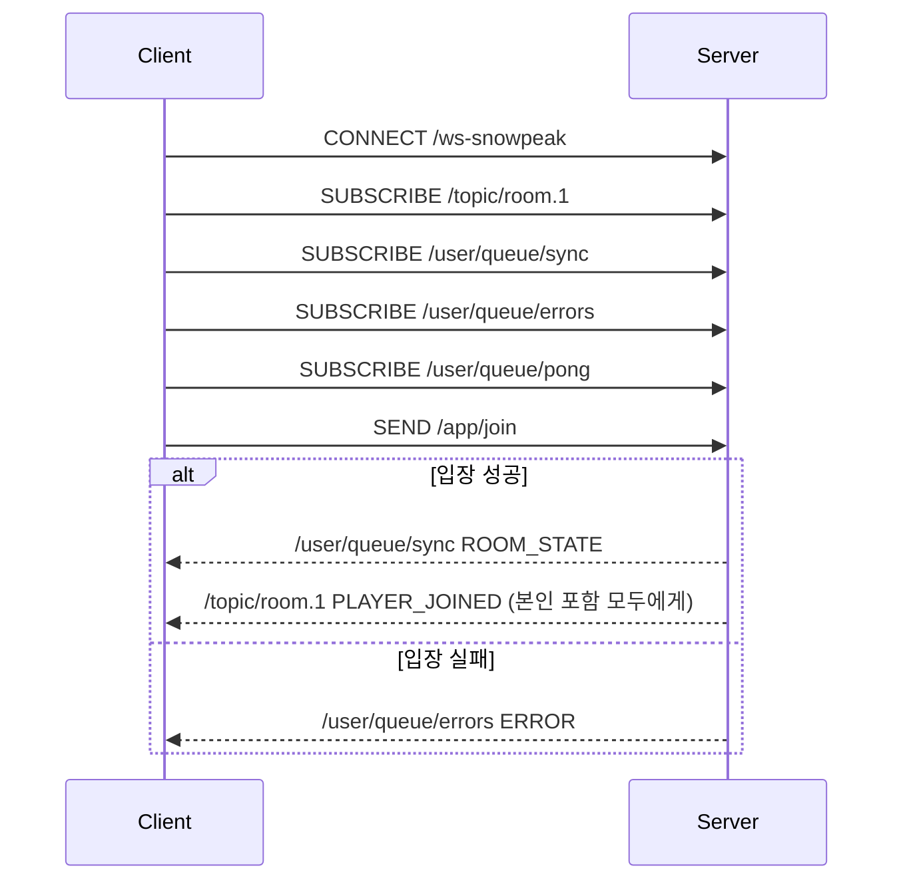

# 메시지 계약 명세 (Client ↔ Server)

> 기준: 현재 백엔드 코드 (`GameController`, `GameService`, `dto/*`)
> 전송: SockJS 엔드포인트 `/ws-snowpeak` 위의 STOMP 1.2
> 프론트엔드 반영 여부: **아직 반영 전** ([남은 작업](./troubleshooting-movement-sync.md) 8-1절)

---

## 1. 연결 순서



**구독을 먼저 끝낸 뒤 `/app/join`을 보내야 합니다.** 구독 전에 도착한 1:1 메시지는 사라집니다.

---

## 2. Client → Server

### `SEND /app/join`

```json
{ "nickname": "alice", "role": "server", "x": 400, "y": 300, "roomId": "1" }
```

| 필드 | 타입 | 필수 | 규칙 |
| --- | --- | --- | --- |
| `nickname` | string | O | 앞뒤 공백 제거 후 1~16자. 방 안에서 유일해야 함 (`HSETNX`) |
| `role` | string | O | `server`, `cook`, `barista`, `hall_server` (대소문자 무관) |
| `x`, `y` | number | - | 0~800, 0~600으로 clamp |
| `roomId` | string | - | 없으면 `"1"` |

### `SEND /app/move`

```json
{ "x": 412, "y": 305, "direction": "right", "animState": "WALK", "sentAt": 1760600000000 }
```

| 필드 | 타입 | 필수 | 규칙 |
| --- | --- | --- | --- |
| `x`, `y` | number | O | 맵 범위로 clamp |
| `direction` | string | - | `up` / `down` / `left` / `right` |
| `animState` | string | - | `IDLE` / `WALK`. 없으면 `WALK` |
| `sentAt` | number(ms) | - | 보낸 시각. 브로드캐스트에 그대로 실려 돌아옴 (지연 측정용) |

- **`playerId`, `roomId`는 보내지 않습니다.** 서버가 세션에 저장된 값으로 판단합니다.
- 입장 전에 보낸 이동은 무시됩니다.
- 같은 세션의 이동은 **보낸 순서대로** 처리됩니다 (`setPreserveReceiveOrder`).

### `SEND /app/ping`

```json
{ "sentAt": 1760600000000 }
```

---

## 3. Server → Client

모든 메시지는 같은 형식입니다.

```json
{ "type": "MOVE", "payload": { ... }, "serverTime": 1760600000012, "sentAt": 1760600000000 }
```

| type | 목적지 | payload | sentAt |
| --- | --- | --- | --- |
| `ROOM_STATE` | `/user/queue/sync` | `PlayerState[]` (본인 포함) | - |
| `PLAYER_JOINED` | `/topic/room.{roomId}` | `PlayerState` | - |
| `MOVE` | `/topic/room.{roomId}` | `PlayerState` | 원본 `sentAt` |
| `PLAYER_LEFT` | `/topic/room.{roomId}` | `{ "playerId": "alice" }` | - |
| `PONG` | `/user/queue/pong` | `null` | 원본 `sentAt` |
| `ERROR` | `/user/queue/errors` | `{ "code": "...", "message": "..." }` | - |

### PlayerState

```json
{
  "playerId": "alice",
  "x": 412.0,
  "y": 305.0,
  "direction": "right",
  "role": "SERVER",
  "animState": "WALK",
  "roomId": "1",
  "status": "MOVE"
}
```

`playerId`가 닉네임입니다. 별도의 `nickname` 필드는 없습니다.

### 에러 코드

| code | 발생 조건 |
| --- | --- |
| `INVALID_NICKNAME` | 닉네임이 비었거나 16자 초과 |
| `INVALID_ROLE` | 정의되지 않은 역할 |
| `NICKNAME_TAKEN` | 같은 방에 같은 닉네임이 이미 있음 |

---

## 4. 지연 측정 방법

| 측정 | 방법 | 주의 |
| --- | --- | --- |
| RTT (왕복) | `/app/ping {sentAt: Date.now()}` → `PONG` 수신 시 `Date.now() - sentAt` | 내 시계만 쓰므로 어느 환경에서나 정확 |
| 이동 전달 지연 (단방향) | `MOVE` 수신 시 `Date.now() - sentAt` | 보낸 사람과 받는 사람의 시계가 같아야 함 → **같은 PC의 브라우저 탭 두 개**로 측정 |
| 서버 처리 시점 | `serverTime - sentAt` | 클라이언트와 서버 시계 차이 포함 |

---

## 5. 서버 내부 저장

| 항목 | 값 |
| --- | --- |
| Redis 키 | `room:{roomId}` (Hash) |
| Field | `playerId` |
| Value | `PlayerState` JSON (`GenericJackson2JsonRedisSerializer`) |
| 입장 | `HSETNX` |
| 이동 | 메모리 `pendingMoves`에 최신값만 보관 → 100ms마다 Lua `UPDATE_IF_PRESENT` |
| 퇴장 | `HDEL` (반환값이 1일 때만 `PLAYER_LEFT`) |
| 서버 시작 | `SCAN room:*` → `DEL` (`snowpeak.redis.clear-on-startup=true`) |

| 설정 | 기본값 |
| --- | --- |
| `snowpeak.sync.flush-interval-ms` | `100` |
| `snowpeak.redis.clear-on-startup` | `true` |
