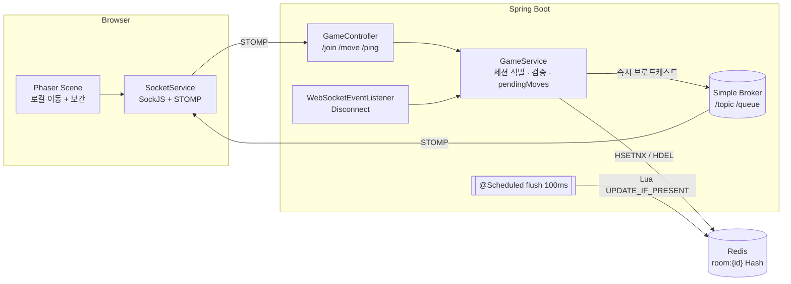

# Snowpeak Game — 포트폴리오 요약

> 실시간 멀티플레이 협동 카페 운영 게임 · 개인 프로젝트 · 2025.12 ~
> **Backend** Java 17, Spring Boot 3.5, Spring WebSocket(STOMP/SockJS), Redis(Lettuce, Lua) · **Frontend** React, TypeScript, Phaser 3

---

## 이력서용 한 줄 요약 (골라 쓰기)

- 브라우저 환경의 TCP(WebSocket/STOMP) 제약 속에서 **전송 주기 제한(60→20Hz)·클라이언트 보간·Redis 쓰기 지연**으로 멀티플레이 캐릭터 동기화 지연 개선
- Redis **HSETNX·Lua Script**로 닉네임 중복 덮어쓰기와 퇴장 플레이어 부활 경쟁 조건을 원자적으로 해결
- 이동마다 발생하던 Redis 동기 쓰기를 **100ms 배치 + Lua 1회**로 바꿔 Redis 호출을 **초당 200회 → 방당 최대 10회**로 감축 (10명·20Hz 기준)
- 통합 테스트로 **Spring STOMP inbound 스레드 풀에 의한 이동 메시지 순서 역전**을 재현(7회 중 5회)하고 `preserveReceiveOrder`로 해결
- 실제 서버 + SockJS/STOMP 클라이언트 기반 **통합 테스트 8개, 실제 Redis 테스트 3개** 도입 (기존 테스트 0개)

---

## 트러블슈팅 (STAR)

### 1. TCP 환경에서의 캐릭터 이동 지연 · 끊김

| | |
| --- | --- |
| **Situation** | 브라우저 게임이라 UDP를 쓸 수 없어 WebSocket(TCP)으로 위치를 동기화. 다른 플레이어가 멈췄다 몰아서 움직이고 순간이동함 |
| **Task** | 프로토콜을 바꾸지 않고 TCP 안에서 체감 지연과 끊김을 줄이기 |
| **Action** | 매 프레임(약 60Hz) 전송 → 50ms 주기(20Hz) + 정지 시 미전송 · 내 캐릭터는 로컬 즉시 이동 · 원격 캐릭터는 목표 좌표 + Lerp 보간 · 지연 구간을 5개로 나눠 바꿀 수 있는 구간에 집중 |
| **Result** | 1인당 송신 메시지 최대 1/3로 감소, 순간이동 제거. Lerp 계수의 표시 지연(약 236ms)을 계산해 다음 개선(스냅샷 보간) 근거 확보 |

→ [상세 문서](./troubleshooting-movement-sync.md)

### 2. Redis 플레이어 상태 — 유령 · 덮어쓰기 · 쓰기 부하

| | |
| --- | --- |
| **Situation** | 서버 재시작 후 유령 플레이어 잔존, 같은 닉네임 입장 시 기존 플레이어 덮어쓰기, 클라이언트 값을 믿어 `room:null` 키 생성, 이동마다 Redis 동기 쓰기 |
| **Task** | 상태 저장소의 정합성을 지키면서 위치 전달 경로에서 Redis 대기를 제거 |
| **Action** | `HSETNX`로 닉네임 선점 · 세션 속성 기반 식별 · 이동은 즉시 브로드캐스트하고 저장은 100ms 배치 · 배치가 만든 "퇴장자 부활" 경쟁 조건을 Lua `HEXISTS+HSET`로 원자화 · 시작 시 `SCAN` 기반 유령 정리 · 저장소 인터페이스 분리 |
| **Result** | Redis 호출 초당 200회 → 방당 최대 10회. 중복 입장·부활·`room:null` 재현 테스트 모두 통과 |

→ [상세 문서](./troubleshooting-redis-player-state.md)

### 3. TCP인데 이동 순서가 뒤바뀜

| | |
| --- | --- |
| **Situation** | 같은 클라이언트가 보낸 이동 `(10,20)→(30,40)` 중 `(10,20)`이 최종 저장됨. 7회 중 5회 재현 |
| **Task** | 원인을 확정하고, 처리량을 해치지 않으면서 순서를 보장 |
| **Action** | 대기를 넣으면 통과한다는 사실만으로 덮지 않고 실패 시점 상태를 출력해 원인 확정 → STOMP inbound 스레드 풀의 병렬 처리. `setPreserveReceiveOrder` / `setPreservePublishOrder`로 **세션 안에서만 직렬화** |
| **Result** | 이동 30개 연속 전송 테스트 포함 전체 11개 × 5회 반복 통과 |

→ [상세 문서](./troubleshooting-message-ordering.md)

### 4. 로그인 없는 세션에 1:1 메시지 미도착

| | |
| --- | --- |
| **Situation** | 늦은 입장자에게 보낸 기존 플레이어 목록이 예외 없이 사라짐. 우회로 쓴 `/topic/private/{nickname}`은 누구나 구독 가능 |
| **Task** | 인증 없이 특정 세션에만 안전하게 전달 |
| **Action** | 세션 ID 헤더를 붙인 `convertAndSendToUser` + `/queue` 브로커 등록 + `/user/queue/*` 구독. N개 메시지를 `ROOM_STATE` 1개로 통합 |
| **Result** | sync·errors·pong 3개 1:1 채널을 테스트로 검증 |

→ [상세 문서](./troubleshooting-stomp-user-destination.md)

---

## 아키텍처

---

## 배운 점

1. **데이터 성격이 전송 전략을 결정합니다.** 위치(최신 값만 중요)와 주문(유실 불가)은 같은 게임 안에서도 다르게 다뤄야 합니다.
2. **원자성은 명령 하나 단위로 생각합니다.** 확인과 쓰기를 나누는 순간 경쟁 조건이 생깁니다.
3. **최적화는 새로운 버그를 만듭니다.** 쓰기 지연을 넣자 곧바로 "퇴장자 부활"이 생겼고, 불변식을 테스트로 지켰습니다.
4. **순서 보장은 계층마다 따로 확인합니다.** TCP의 순서 보장은 애플리케이션 스레드 풀까지 이어지지 않습니다.
5. **큰 변경은 계약을 먼저 고정합니다.** 한 번에 재설계했다가 되돌린 경험 이후, 메시지 계약을 문서화하고 테스트로 지켰습니다.

---

## 다음 단계

- 프론트엔드를 새 메시지 계약(`/user/queue/*`, `{type, payload}`)에 맞추고, 정지 순간의 마지막 위치를 즉시 전송
- 스냅샷 보간과 데드 레커닝으로 표시 지연 단축, `sentAt` 기반 p50/p95 실측
- STOMP Broker Relay(RabbitMQ) 또는 Redis Pub/Sub로 다중 서버 지원
- 주문·서빙 동시성 제어에 Lua 패턴 확장 (README의 "음식 동시 픽업" 문제)
