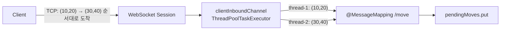

# 트러블슈팅: "TCP는 순서를 보장한다"는데 왜 이동 순서가 뒤바뀌었나

> **프로젝트**: Snowpeak Game
> **스택**: Spring Boot 3.5 (Spring Framework 6.2), Spring WebSocket STOMP, Simple Broker
> **한 줄 요약**: 같은 클라이언트가 보낸 이동 메시지가 서버에서 **보낸 순서와 다르게 처리**되어 예전 위치가 최종값으로 남았습니다. Spring의 inbound 스레드 풀이 원인이었고, `setPreserveReceiveOrder(true)`로 해결했습니다.

---

## 1. 발견 경위

Redis 저장 구조를 바꾸면서 **"연속으로 움직이면 마지막 위치가 저장되는가"** 를 확인하는 통합 테스트를 작성했습니다.

```java
alice.session.send("/app/move", Map.of("x", 10, "y", 20, "direction", "up"));
alice.session.send("/app/move", Map.of("x", 30, "y", 40, "direction", "up"));

awaitCondition(() -> playerRepository.findAll("1").stream()
        .anyMatch(p -> p.getX() == 30 && p.getY() == 40));   // 3초 안에 (30,40)이 저장돼야 함
```

이 테스트가 **간헐적으로 실패**했습니다. 7번 실행해 5번 실패했고, 4번 연속 실패한 적도 있었습니다.

## 2. 가설 검증

| 가설 | 확인 방법 | 결과 |
| --- | --- | --- |
| 스케줄러(flush)가 동작하지 않는다 | 두 번째 send 뒤 500ms 대기 후 저장소 출력 | `x=30.0` 저장됨 → **기각** (대기를 넣으면 통과) |
| 메시지 처리 순서가 바뀐다 | 대기 없이, 실패 시점의 저장소 상태 출력 | **`x=10.0, y=20.0`이 최종값** → **채택** |

```
DEBUG timeout store=[PlayerState(playerId=alice, x=10.0, y=20.0, direction=up, ...)]
```

flush는 정상이었습니다. 문제는 **두 번째 메시지 `(30,40)`가 첫 번째 `(10,20)`보다 먼저 처리됐고**, 마지막에 처리된 `(10,20)`이 "최신 위치"로 남은 것이었습니다.

## 3. 원인: TCP 순서 ≠ 애플리케이션 처리 순서



- TCP와 WebSocket은 **바이트와 프레임이 도착하는 순서**를 보장합니다.
- Spring STOMP는 도착한 메시지를 `clientInboundChannel`에 넣고, **스레드 풀**이 꺼내 `@MessageMapping` 메서드를 실행합니다.
- 같은 세션의 메시지라도 **서로 다른 스레드에 배정될 수 있고**, 어느 스레드가 먼저 끝날지는 보장되지 않습니다.
- 그 결과 `pendingMoves.put(nickname, state)`가 **나중에 실행된 쪽(옛 위치)으로 덮어써졌습니다.**

같은 원리로 **서버 → 클라이언트 방향**(`clientOutboundChannel`)에서도 브로드캐스트 순서가 섞일 수 있습니다.

### 게임에서 나타나는 증상

| 위치 | 증상 |
| --- | --- |
| 다른 플레이어 화면 | 캐릭터가 순간적으로 **뒤로 튀었다가** 다시 앞으로 감 |
| Redis 저장값 | 플레이어가 멈춘 뒤에도 **조금 전 위치**가 저장됨 → 새 입장자에게 틀린 위치가 SYNC됨 |
| 부하가 클수록 | 스레드 경쟁이 심해져 **더 자주 발생** → 로컬에서 혼자 테스트할 때는 잘 안 보임 |

## 4. 해결

```java
@Override
public void configureMessageBroker(MessageBrokerRegistry config) {
    config.enableSimpleBroker("/topic", "/queue");
    config.setApplicationDestinationPrefixes("/app");
    config.setPreservePublishOrder(true);    // 서버 → 클라이언트: 세션별 발신 순서 보장
}

@Override
public void registerStompEndpoints(StompEndpointRegistry registry) {
    registry.addEndpoint("/ws-snowpeak").setAllowedOriginPatterns("*").withSockJS();
    registry.setPreserveReceiveOrder(true);  // 클라이언트 → 서버: 세션별 수신 순서 보장 (Spring 6.1+)
}
```

| 옵션 | 동작 | 비용 |
| --- | --- | --- |
| `setPreserveReceiveOrder(true)` | 같은 세션의 inbound 메시지를 **하나 처리가 끝나야 다음 것을 처리** | 한 세션 안에서만 직렬화. **세션끼리는 계속 병렬**이므로 전체 처리량 영향은 작음 |
| `setPreservePublishOrder(true)` | 같은 세션으로 나가는 메시지를 **보낸 순서대로** 전달 | 세션별 발신 큐 관리 비용 |

### 검토했지만 택하지 않은 대안

| 대안 | 택하지 않은 이유 |
| --- | --- |
| 메시지마다 `seq` 번호를 붙여 오래된 것을 버림 | 클라이언트 수정이 필요합니다. 연결 하나 안의 순서 문제는 프레임워크 설정으로 해결되므로, **재연결·다중 서버용**으로 남겨 둠 |
| `synchronized`로 서비스 메서드 잠금 | 순서는 보장하지 못하고(락 획득 순서 ≠ 도착 순서) **모든 세션을 직렬화**해 처리량만 떨어짐 |
| inbound 스레드 풀 크기를 1로 | 순서는 맞지만 **전체 서버가 단일 스레드**가 됨 |

## 5. 검증

테스트를 더 엄격하게 바꿨습니다. 같은 세션에서 **이동 30개를 연속으로** 보내고, 마지막 `(30,40)`이 저장되는지 확인합니다.

```java
for (int x = 1; x <= 29; x++) {
    alice.session.send("/app/move", Map.of("x", x, "y", 20, "direction", "up"));
}
alice.session.send("/app/move", Map.of("x", 30, "y", 40, "direction", "up"));
```

| 조건 | 결과 |
| --- | --- |
| 수정 전 (이동 2개) | 7회 실행 중 5회 실패 |
| 수정 후 (이동 30개) | 전체 테스트 11개 × **5회 반복 모두 통과** |

## 6. 배운 점

- **"TCP는 순서를 보장한다"는 네트워크 계층까지의 이야기입니다.** 그 위에서 큐와 스레드 풀을 거치면 순서는 다시 깨질 수 있습니다. 순서가 중요하면 **어느 계층에서 보장되는지** 확인해야 합니다.
- **동시성 버그는 로컬에서 혼자 돌려서는 잘 안 보입니다.** 메시지를 연속으로 보내는 테스트를 만들어 두지 않았다면, 실제 사용자가 몰렸을 때 처음 발견했을 문제입니다.
- **원인을 확인하기 전에 고치지 않았습니다.** "대기를 넣으면 통과한다"는 사실만 보고 `sleep`을 넣었다면 버그를 숨겼을 것입니다. 실패 순간의 상태를 출력해 **원인을 확정한 뒤** 수정했습니다.
