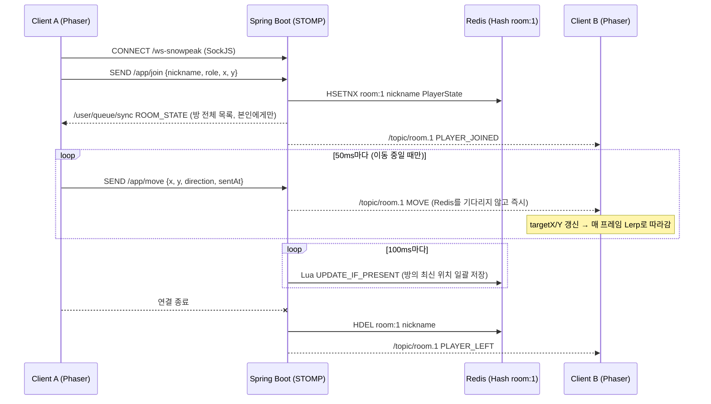

# 트러블슈팅: TCP(WebSocket/STOMP) 환경에서 멀티플레이 캐릭터 이동 동기화 개선

> **프로젝트**: Snowpeak Game — 실시간 멀티플레이 협동 타이쿤 게임
> **기간**: 2025.12.15 ~ 2026.01.07 (커밋 `309dae5` ~ `957ab29`)
> **스택**: Java 17, Spring Boot 3.x, Spring WebSocket(STOMP + SockJS), Redis(Lettuce), React + Phaser 3, @stomp/stompjs

---

## 1. 한 줄 요약

브라우저 게임은 UDP를 쓸 수 없어 **TCP 위의 WebSocket(STOMP)** 으로 캐릭터 위치를 동기화해야 했습니다.
이 구조에서 생기는 **이동 지연·끊김**과 **입장 시점 상태 불일치**를 줄이기 위해
① 클라이언트 전송 빈도 제한(Throttle), ② 선형 보간(Lerp), ③ 서버 역할 분리, ④ 접속/퇴장 이벤트 브로드캐스트,
⑤ 신규 입장자 초기 상태 동기화(SYNC)를 단계적으로 적용했습니다.

---

## 2. 배경: 왜 TCP로 실시간 게임을 만들었나

### 2-1. 일반적인 게임 서버는 UDP를 쓴다

| 구분 | TCP | UDP |
| --- | --- | --- |
| 전달 보장 | 보장 (손실 시 재전송) | 보장 안 함 |
| 순서 보장 | 보장 | 보장 안 함 |
| 지연 특성 | 패킷 하나가 유실되면 뒤 패킷이 모두 대기 (**Head-of-Line Blocking**) | 유실된 패킷만 버리고 다음 패킷 바로 처리 |
| 실시간 게임 적합성 | 낮음 | 높음 |

위치 데이터는 **"최신 값 하나만 의미 있는"** 데이터입니다. 100ms 전 위치가 유실됐다면 다시 받을 필요 없이 다음 위치를 쓰면 됩니다.
그래서 FPS·MMO 같은 게임은 UDP 위에 필요한 신뢰성만 직접 구현합니다.

### 2-2. 그런데 이 프로젝트는 UDP를 쓸 수 없었다

- 클라이언트가 **웹 브라우저**(React + Phaser)입니다. 브라우저 JavaScript에는 **raw UDP 소켓 API가 없습니다.**
- 브라우저에서 쓸 수 있는 실시간 양방향 통신은 사실상 **WebSocket(TCP 기반)** 입니다.
- 브라우저에서 UDP 성격의 통신을 쓰는 방법(WebRTC DataChannel, WebTransport)은 시그널링 서버·별도 인프라가 필요하고, Spring 생태계 지원도 약해 학습 범위를 넘어선다고 판단했습니다.
- 서버 측에서는 Spring의 STOMP 메시지 브로커를 쓰면 방(room) 단위 Pub/Sub, 세션 관리, 연결 끊김 이벤트를 바로 쓸 수 있었습니다.

**결론**: 프로토콜 자체를 바꾸기보다, **"TCP라는 제약 안에서 체감 지연을 얼마나 줄일 수 있는가"** 를 과제로 잡았습니다.

---

## 3. 시스템 구조



> 위 흐름은 이 문서 작성 후 백엔드를 정리한 **현재 구조**입니다. 변경 과정은 [Redis 상태 관리 트러블슈팅](./troubleshooting-redis-player-state.md)에 있습니다.

| 계층 | 역할 | 주요 파일 |
| --- | --- | --- |
| 전송 | STOMP 엔드포인트 `/ws-snowpeak`, Simple Broker `/topic`, 앱 prefix `/app` | `global/config/WebSocketConfig.java` |
| 진입점 | `/app/join`, `/app/update` 메시지 수신 | `controller/GameController.java` |
| 비즈니스 | 상태 저장, 브로드캐스트, 퇴장 처리, 전체 목록 조회 | `service/GameService.java` |
| 상태 저장소 | `room:{roomId}` Hash에 플레이어별 `PlayerState` JSON 저장 | `global/config/RedisConfig.java` |
| 세션 이벤트 | `SessionDisconnectEvent` 감지 → 퇴장 처리 | `listener/WebSocketEventListener.java` |
| 클라이언트 | 입력 처리, 전송 Throttle, 원격 캐릭터 보간 | `frontend/src/game/MainScene.ts`, `frontend/src/services/SocketService.ts` |

---

## 4. 문제 상황

### 문제 ① 다른 플레이어 캐릭터가 뚝뚝 끊기며 순간이동한다

초기 구현(`309dae5`, `static/game.js`)은 Phaser의 `update()` 루프 안에서 **움직이는 매 프레임마다** 위치를 전송했습니다.

```js
// 309dae5 - 초기 구현: 매 프레임(약 60회/초) 전송
if (moveData.animState === 'WALK') {
    stompClient.publish({ destination: `/app/move`, body: JSON.stringify(moveData) });
}
```

- 플레이어 1명이 걷는 동안 초당 약 60개의 메시지가 나갑니다. 서버는 이를 방 인원 수만큼 다시 브로드캐스트하므로, N명이면 서버 송신량은 대략 **60 × N × (N−1) 개/초** 입니다.
- TCP는 순서를 보장하므로, 한 메시지가 늦어지면 뒤 메시지들이 줄줄이 밀립니다(HOL Blocking). 그 결과 받는 쪽에서는 **한동안 멈췄다가 몰아서 이동**하는 현상이 보였습니다.

### 문제 ② 늦게 들어온 플레이어에게 기존 플레이어가 보이지 않는다

입장 메시지는 `/topic/room.{id}`로 **그 순간 구독 중인 사람에게만** 전달됩니다.
나중에 들어온 사람은 이전에 들어온 사람의 JOIN 메시지를 받을 수 없어, **기존 플레이어가 움직이기 전까지 화면에 나타나지 않았습니다.**

### 문제 ③ 나간 플레이어의 캐릭터가 화면에 남는다 (유령 캐릭터)

브라우저를 닫거나 네트워크가 끊겨도 서버는 이를 따로 처리하지 않았습니다.
Redis에는 퇴장한 플레이어 데이터가 남고, 다른 클라이언트 화면에도 캐릭터가 그대로 남았습니다.

### 문제 ④ 메시지 형식이 흔들리면서 동기화 자체가 깨졌다

역할(`role`)을 `String`으로 받아 `Role.valueOf(role.toUpperCase())`로 바꾸는 구조였습니다.
클라이언트가 정의되지 않은 값(`"hall"` 등)을 보내면 `IllegalArgumentException`이 발생해 **입장 처리 전체가 실패**할 수 있었습니다.

---

## 5. 원인 분석

### 5-1. 지연이 생기는 구간을 나눠 보기

캐릭터 이동이 다른 사람 화면에 보이기까지의 지연은 아래 구간의 합입니다.

```
체감 지연 = ① 전송 대기(Throttle 주기)
          + ② 네트워크 왕복(클라 → 서버)
          + ③ 서버 처리(역직렬화 → Redis HSET → 직렬화 → 브로커 전달)
          + ④ 네트워크(서버 → 다른 클라)
          + ⑤ 클라이언트 렌더링 보간(Lerp)이 목표에 도달하는 시간
```

TCP 자체(②, ④)는 애플리케이션에서 바꾸기 어렵습니다.
그래서 **바꿀 수 있는 ①, ③, ⑤ 와 메시지 수(혼잡도)** 에 집중했습니다.

### 5-2. 원인별 정리

| 증상 | 원인 | 분류 |
| --- | --- | --- |
| 끊김·몰아치기 | 매 프레임 전송으로 메시지 폭증 → TCP 송신 버퍼·브로커 큐 적체 → HOL Blocking 체감 증가 | 전송 빈도 |
| 순간이동 | 받은 좌표를 그대로 대입 → 메시지 간격만큼 위치가 계단식으로 점프 | 렌더링 |
| 늦은 입장자에게 안 보임 | 브로드캐스트는 "현재 구독자"에게만 전달, 입장 시 현재 상태를 줄 경로 없음 | 상태 동기화 |
| 유령 캐릭터 | 연결 끊김 이벤트 미처리, Redis 정리 없음 | 세션 생명주기 |
| 입장 실패 | String ↔ Enum 수동 변환, DTO 간 필드 불일치 | 메시지 계약 |

---

## 6. 해결 과정

### 6-1. 클라이언트: 전송 빈도 제한 (Throttle, 60Hz → 20Hz)

**매 프레임 전송 → 50ms마다 1번 전송**으로 바꿨습니다. 내 캐릭터는 로컬에서 즉시 움직이고(Client-side movement), 네트워크로는 요약된 위치만 보냅니다.

```ts
// frontend/src/game/MainScene.ts
private moveThrottle: number = 50; // ms between move sends

// 내 캐릭터는 입력 즉시 로컬에서 이동 (네트워크 응답을 기다리지 않음)
this.me.x = newX;
this.me.y = newY;

// 네트워크 전송은 50ms에 한 번만
if (time - this.lastMoveTime > this.moveThrottle) {
  this.socketService.sendMove(Math.round(newX), Math.round(newY), direction);
  this.lastMoveTime = time;
}
```

- 1인당 송신 메시지 수: **약 60개/초 → 최대 20개/초 (약 1/3)**
- 좌표를 `Math.round`로 정수화해 JSON 페이로드 크기도 줄였습니다.
- 멈춰 있을 때(`vx === 0 && vy === 0`)는 아예 보내지 않습니다.
- 대각선 이동은 `0.707`(≈ 1/√2)을 곱해 속도를 일정하게 맞췄습니다. 초기 코드에는 아래 방향키에 `-speed`가 들어가 위로 움직이는 버그도 있었는데, 이 과정에서 함께 고쳤습니다.

### 6-2. 클라이언트: 선형 보간(Lerp)으로 순간이동 제거

전송 빈도를 줄이면 받는 쪽 좌표 간격이 커져 계단식 이동이 더 눈에 띕니다. 그래서 받은 좌표를 **바로 대입하지 않고 "목표 위치"로만 저장**한 뒤, 매 프레임 조금씩 따라가게 했습니다.

```ts
// 수신 시: 목표 위치만 갱신
private handlePlayerMove(player: PlayerState) {
  const sprite = this.players.get(player.playerId);
  if (sprite && sprite !== this.me) {
    sprite.targetX = player.x;
    sprite.targetY = player.y;
  }
}

// 매 프레임: 현재 위치 → 목표 위치로 15%씩 접근
this.players.forEach((sprite) => {
  if (sprite !== this.me && sprite.targetX !== undefined && sprite.targetY !== undefined) {
    sprite.x = Phaser.Math.Linear(sprite.x, sprite.targetX, this.lerpFactor); // 0.15
    sprite.y = Phaser.Math.Linear(sprite.y, sprite.targetY, this.lerpFactor);
  }
});
```

**트레이드오프 계산**: 60fps에서 계수 0.15로 남은 거리의 90%를 따라잡는 데는
`ln(0.1) / ln(0.85) ≈ 14프레임 ≈ 236ms`가 걸립니다.
즉 Lerp는 **부드러움을 얻는 대신 표시 지연을 늘리는 장치**입니다. 계수를 키우면 반응은 빨라지지만 다시 끊겨 보이므로, 20Hz 전송 주기와 함께 조정해야 하는 값이라는 점을 알게 됐습니다.

### 6-3. 서버: Controller / Service 분리 (`2aaaa88`)

초기에는 `GameController`가 Redis 저장과 브로드캐스트를 모두 했습니다. 이를 `GameService`로 옮겨 **메시지 진입점과 동기화 로직을 분리**했습니다.

```java
// GameController.java — 진입점은 세션 처리와 위임만
@MessageMapping("/join")
public void handleJoin(@Payload GameMessage message, SimpMessageHeaderAccessor headerAccessor) {
    headerAccessor.getSessionAttributes().put("nickname", message.getNickname());
    gameService.joinPlayer(message, headerAccessor.getSessionId());
}

@MessageMapping("/update")
public void handleUpdate(@Payload PlayerState playerState) {
    gameService.updatePlayer(playerState);
}
```

이후 퇴장 처리, SYNC 같은 동기화 기능을 Service 한 곳에 추가할 수 있는 기반이 됐습니다.

### 6-4. 서버: 연결 종료 감지 → Redis 정리 → LEAVE 브로드캐스트 (`2aaaa88`, `fd9e27b`)

입장할 때 **WebSocket 세션 속성에 닉네임을 저장**해 두고, Spring이 발행하는 `SessionDisconnectEvent`에서 꺼내 정리합니다.
사용자가 "나가기"를 누르지 않고 탭을 닫거나 네트워크가 끊겨도 처리됩니다.

```java
// WebSocketEventListener.java
@EventListener
public void handleWebSocketDisconnectListener(SessionDisconnectEvent event) {
    StompHeaderAccessor headerAccessor = StompHeaderAccessor.wrap(event.getMessage());
    String nickname = (String) headerAccessor.getSessionAttributes().get("nickname");
    if (nickname != null) {
        gameService.removePlayer(nickname);
    }
}
```

```java
// GameService.removePlayer — Redis에서 지우고 다른 플레이어에게 알림
if (hashOperations.hasKey(key, nickname)) {
    hashOperations.delete(key, nickname);

    PlayerState leaveMessage = new PlayerState();
    leaveMessage.setPlayerId(nickname);
    leaveMessage.setStatus("LEAVE");
    messagingTemplate.convertAndSend("/topic/room." + ROOM_ID, leaveMessage);
}
```

`PlayerState`에 `status` 필드(`JOIN` / `LEAVE`)를 추가해, 같은 토픽 안에서 클라이언트가 입장·이동·퇴장을 구분할 수 있게 했습니다.

### 6-5. 서버: 신규 입장자 초기 상태 동기화 — SYNC (`957ab29`)

늦게 들어온 사람에게 **현재 방 전체 상태를 한 번에** 보내는 `SYNC` 메시지를 추가했습니다.
기존에는 플레이어 수만큼 메시지를 따로 보냈다면(`convertAndSendToUser` 반복), 이제는 **목록 하나를 메시지 1개에 담아** 보냅니다.

```java
// GameController.handleJoin
gameService.joinPlayer(message, sessionId);           // 1) 기존 사람들에게 "입장" 브로드캐스트

List<PlayerState> currentPlayers = gameService.getAllPlayers(); // 2) Redis에서 방 전체 조회

GameMessage syncMessage = new GameMessage();
syncMessage.setType(GameMessage.MessageType.SYNC);
syncMessage.setPlayers(currentPlayers);

messagingTemplate.convertAndSend("/topic/private/" + message.getNickname(), syncMessage); // 3) 입장자 본인에게만
```

```java
// GameService.getAllPlayers — 서버 메모리가 아니라 Redis를 기준(Source of Truth)으로 조회
public List<PlayerState> getAllPlayers() {
    List<PlayerState> playerList = hashOperations.values(PLAYER_KEY_PREFIX + ROOM_ID);
    return playerList == null ? new ArrayList<>() : playerList;
}
```

| 방식 | 입장자가 받는 메시지 수 (기존 N명) | 상태 기준 |
| --- | --- | --- |
| 변경 전 | N개 (플레이어마다 1개) | Redis |
| 변경 후 (SYNC) | **1개** (목록 통째로) | Redis |

### 6-6. 시행착오: 구조를 한 번에 갈아엎었다가 되돌린 경험 (`bb3b885` → `f8cefed`)

동기화 필드(`direction`, `animState`, `roomId`)와 `Role` Enum 타입 통일을 하면서, `bb3b885`에서 Controller를 다음처럼 **한 번에 재설계**했습니다.

- 엔드포인트를 `/app/game/message` 하나로 통합하고 `switch(type)`으로 분기
- 상태 저장소를 Redis에서 **`static ConcurrentHashMap`(서버 메모리)** 으로 변경
- `GameService`를 거치지 않고 Controller에서 직접 처리

결과적으로 다음 문제가 생겼습니다.

1. 클라이언트는 여전히 `/app/join`, `/topic/room.{id}`를 쓰는데 서버는 `/app/game/message`, `/topic/room/{id}`(점 → 슬래시)를 써서 **메시지가 아예 오가지 않음**
2. `WebSocketEventListener → GameService.removePlayer`는 Redis를 지우지만 Controller는 메모리 Map을 써서 **저장소가 두 개로 갈라짐**
3. 서버를 여러 대로 늘리면 메모리 Map은 공유되지 않아 **Redis를 쓴 이유 자체가 사라짐**

그래서 `f8cefed`에서 **직전의 동작하던 구조로 되돌렸고**, 이후 `957ab29`에서는 기존 구조를 유지한 채 SYNC 기능만 추가하는 방식으로 다시 진행했습니다.

> **배운 점**: 동기화 코드는 "클라이언트와 서버가 같은 계약(목적지 경로, 메시지 형식)을 공유한다"는 전제 위에서만 동작합니다. 계약을 바꾸는 변경은 양쪽을 함께 바꾸거나, 작은 단위로 나눠 하나씩 검증해야 합니다.

---

## 7. 결과

| 항목 | Before | After |
| --- | --- | --- |
| 이동 메시지 전송 빈도 (1인) | 프레임마다 (약 60회/초) | 50ms 간격 (최대 20회/초) |
| 정지 상태 전송 | — | 전송 안 함 |
| 원격 캐릭터 표시 | 좌표 즉시 대입 (계단식 점프) | 목표 좌표 + Lerp(0.15) 보간 |
| 내 캐릭터 반응 | 로컬 이동 | 로컬 이동 유지 (네트워크 대기 없음) |
| 늦은 입장자 | 기존 플레이어가 움직이기 전까지 안 보임 | 입장 즉시 SYNC 1회로 전체 상태 수신 |
| 연결 끊김 | Redis·화면에 캐릭터 잔존 | Disconnect 이벤트로 Redis 삭제 + LEAVE 브로드캐스트 |
| 상태 저장소 | Controller 내부 처리 | Service 계층 + Redis 단일 기준 |

> **TODO (포트폴리오 보강용 정량 지표)**: 아래 값은 아직 측정하지 않았습니다. 측정 후 채워 넣으면 설득력이 크게 올라갑니다.
> - 메시지에 `sentAt = Date.now()`를 넣고 수신 측에서 `Date.now() - sentAt`를 기록 → 평균/p95 지연 (같은 PC 두 탭에서 측정하면 시계 오차 없음)
> - Chrome DevTools → Network → WS 탭에서 초당 프레임 수, 프레임 크기 비교 (Before/After)
> - Chrome DevTools Network throttling(Slow 4G 등)으로 손실·지연 환경에서 끊김 체감 비교 영상/GIF

---

## 8. 남은 문제와 다음 단계

### 8-1. 클라이언트–서버 계약 불일치 → 백엔드 정리 완료, 프론트엔드 반영 남음

문서를 정리하며 코드를 다시 보니, 프론트엔드(`frontend/src`)와 백엔드의 메시지 계약이 맞지 않는 부분이 있었습니다. 백엔드를 프론트엔드가 기대하는 `{type, payload}` 형식으로 맞추고, 통합 테스트로 검증했습니다. 자세한 내용은 [Redis 상태 관리 트러블슈팅](./troubleshooting-redis-player-state.md)과 [메시지 계약 명세](./message-protocol.md)에 정리했습니다.

| 항목 | 프론트엔드 | 기존 백엔드 | 현재 백엔드 |
| --- | --- | --- | --- |
| 이동 전송 경로 | `/app/move` | `/app/update`만 존재 | **`/app/move` 처리** |
| 이동 페이로드 | `{x, y, direction}` | `PlayerState` (`playerId`, `roomId` 필요) | **`MoveRequest {x, y, direction, animState, sentAt}`**, 누구·어느 방인지는 세션으로 판단 |
| 수신 메시지 형태 | `{type, payload}` (`PLAYER_JOINED`, `MOVE`, `PLAYER_LEFT`, `ROOM_STATE`) | `PlayerState`를 그대로 전송 | **`ServerMessage {type, payload, serverTime, sentAt}`**, 타입 이름도 프론트와 일치 |
| 초기 동기화 | 구독 없음 | `/topic/private/{nickname}` | **`/user/queue/sync`** (세션 1:1 전송) |
| 역할 값 | `"server"`, `"cook"` | `COOK` 없음 → 입장 시 예외 | **`COOK` 추가**, 모르는 값은 `INVALID_ROLE` 에러 |

**프론트엔드에 남은 작업** (이번 범위 밖):
- `/user/queue/sync`, `/user/queue/errors`, `/user/queue/pong` 구독 추가
- 서버 payload에는 `nickname` 필드가 없고 `playerId`가 닉네임입니다. 그래서 `player.nickname`으로 "나"를 판별하는 코드는 `player.playerId`로 바꿔야 합니다.
- Vite 개발 서버 포트(`8080`)가 Spring Boot와 겹칩니다. Vite를 다른 포트로 옮기고 `/ws-snowpeak`를 프록시로 넘겨야 합니다.
- 키를 뗀 순간의 마지막 위치를 즉시 한 번 보내야 합니다. 지금은 50ms 전송 주기 사이에 멈추면 마지막 위치가 전달되지 않아, 상대 화면에서 최대 약 10px(200px/s × 50ms) 어긋난 채로 멈춥니다.
- `addMessageHandler(this.handleSocketMessage.bind(this))`와 `removeMessageHandler(...bind(this))`는 서로 다른 함수 객체라서 핸들러가 해제되지 않습니다. 씬을 다시 시작할 때마다 핸들러가 쌓입니다.

### 8-1-1. 테스트로 발견한 "순서 역전" 문제

TCP는 순서를 보장하지만, Spring은 같은 세션의 STOMP 메시지를 **스레드 풀에서 병렬로 처리**할 수 있습니다. 그래서 이동 메시지의 처리 순서가 뒤바뀌었습니다. `setPreserveReceiveOrder(true)`로 해결했고, 과정은 [메시지 순서 역전 트러블슈팅](./troubleshooting-message-ordering.md)에 따로 정리했습니다.

### 8-2. TCP 환경에서 더 해볼 수 있는 개선

| 개선 | 내용 | 기대 효과 |
| --- | --- | --- |
| ~~Redis 쓰기를 핫패스에서 제거~~ **(적용 완료)** | 이동은 즉시 브로드캐스트하고, Redis 저장은 100ms마다 방 단위 Lua Script 1회로 처리 | 서버 처리 지연(③) 감소 |
| 서버 틱(Tick) 기반 배치 전송 | 이동 메시지를 바로 중계하지 않고 서버가 50ms마다 방 전체 상태를 1개 메시지로 전송 | 메시지 수 N² → N, 순서·일관성 향상 |
| 프레임 독립적 보간 | `lerpFactor`를 `1 - Math.pow(1 - k, delta / 16.67)` 형태로 → 주사율(60/144Hz)과 무관하게 같은 속도 | 기기별 체감 차이 제거 |
| 스냅샷 보간(Snapshot Interpolation) | 타임스탬프가 있는 위치를 버퍼에 쌓고 약 100ms 과거 시점을 두 점 사이 보간으로 렌더 | 패킷 간격이 흔들려도 일정한 속도 |
| 데드 레커닝(Dead Reckoning) | 위치와 함께 속도·방향을 보내고, 다음 패킷 전까지 예측 이동 | Lerp 지연(약 236ms) 상쇄 |
| 순서 번호(seq) | 메시지마다 증가하는 번호를 붙여 오래된 위치는 버림. 연결 하나 안에서는 TCP와 `setPreserveReceiveOrder`로 이미 순서가 보장되므로, **재연결이나 다중 서버 상황**에서만 필요 | 재연결·다중 서버 시 역행 방지 |
| SockJS 폴백 확인 | 운영 환경에서 실제 WebSocket으로 연결되는지 확인 (XHR 폴링으로 폴백되면 지연이 크게 증가) | 숨은 지연 제거 |
| 바이너리 직렬화 | JSON 대신 MessagePack 등 | 페이로드 크기 감소 |

### 8-3. UDP 성격 통신으로의 확장 가능성

| 방식 | 특징 | 고려 사항 |
| --- | --- | --- |
| WebRTC DataChannel | 브라우저에서 `ordered: false, maxRetransmits: 0` 설정으로 UDP처럼 사용 가능 | 시그널링 서버, STUN/TURN 인프라 필요. Java 서버 구현 난이도 높음 |
| WebTransport (HTTP/3, QUIC) | 순서 없는 datagram 지원, HOL Blocking 없음 | 서버 측 HTTP/3 지원 필요, 브라우저 지원 범위 확인 필요 |
| 하이브리드 | 입장·퇴장·주문처럼 **신뢰성이 중요한 이벤트는 WebSocket(TCP)**, 위치처럼 **최신 값만 중요한 데이터는 UDP 계열** | 채널 두 개의 상태 일관성 관리 |

이 게임은 FPS처럼 수 ms 단위 판정이 필요한 장르가 아니라 **협동 타이쿤**입니다. 주문·서빙처럼 **절대 유실되면 안 되는 이벤트**가 더 중요하므로, 현재 단계에서는 **TCP를 유지하고 클라이언트 보간·서버 틱으로 체감 지연을 줄이는 방향**이 비용 대비 합리적이라고 판단했습니다.

---

## 9. 회고

1. **프로토콜보다 "데이터의 성격"을 먼저 봐야 한다.** 위치는 최신 값만 의미 있고, 주문은 하나도 잃으면 안 됩니다. 같은 게임 안에서도 데이터마다 요구하는 전달 보장이 다르다는 것을 알게 됐습니다.
2. **네트워크 지연은 없앨 수 없고 "숨기는" 것이다.** 내 캐릭터는 로컬에서 즉시 움직이고, 남의 캐릭터는 보간으로 부드럽게 보여주는 것이 실시간 게임 클라이언트의 기본 전략이라는 것을 직접 확인했습니다.
3. **부드러움과 반응성은 트레이드오프다.** Lerp 계수 하나로 약 236ms의 표시 지연이 생기는 것을 계산해 보고, "체감 품질"을 수치로 따지는 습관이 생겼습니다.
4. **동기화는 상태의 생명주기 전체(입장 → 변경 → 퇴장)를 다뤄야 한다.** 이동만 맞추면 끝이 아니라, 늦은 입장자의 초기 상태와 비정상 종료 정리까지 있어야 화면이 일치합니다.
5. **큰 리팩터링은 작게 나눠야 한다.** 한 번에 구조를 바꿨다가 계약이 어긋나 되돌린 경험(`bb3b885` → `f8cefed`)으로, 클라이언트–서버 계약을 먼저 고정하고 단계별로 검증하는 방식의 중요성을 배웠습니다.

---

## 부록: 관련 커밋

| 커밋 | 날짜 | 내용 |
| --- | --- | --- |
| `957ab29` | 2026-01-07 | 신규 입장자 초기 상태 동기화(SYNC), Redis 기반 `getAllPlayers` |
| `f8cefed` | 2026-01-05 | 메모리 Map 기반 재설계 되돌림 (Redis + Service 구조 복원) |
| `bb3b885` | 2026-01-04 | 단일 엔드포인트 + `ConcurrentHashMap` 구조 시도 |
| `0af1720` | 2026-01-04 | `joinPlayer` 타입 불일치 수정, direction/animState 매핑 |
| `59c6c60` | 2026-01-04 | `GameMessage` Role Enum화, 동기화 필드 추가 |
| `fd9e27b` | 2025-12-30 | JOIN/LEAVE 상태 브로드캐스트 |
| `2aaaa88` | 2025-12-29 | Controller/Service 분리, `SessionDisconnectEvent` 기반 퇴장 처리 |
| `9670dfa` | 2025-12-18 | Redis 기반 입장 처리, 기존 플레이어 목록 전송 |
| `309dae5` | 2025-12-15 | 초기 구현 (매 프레임 전송 + Lerp 프로토타입) |
